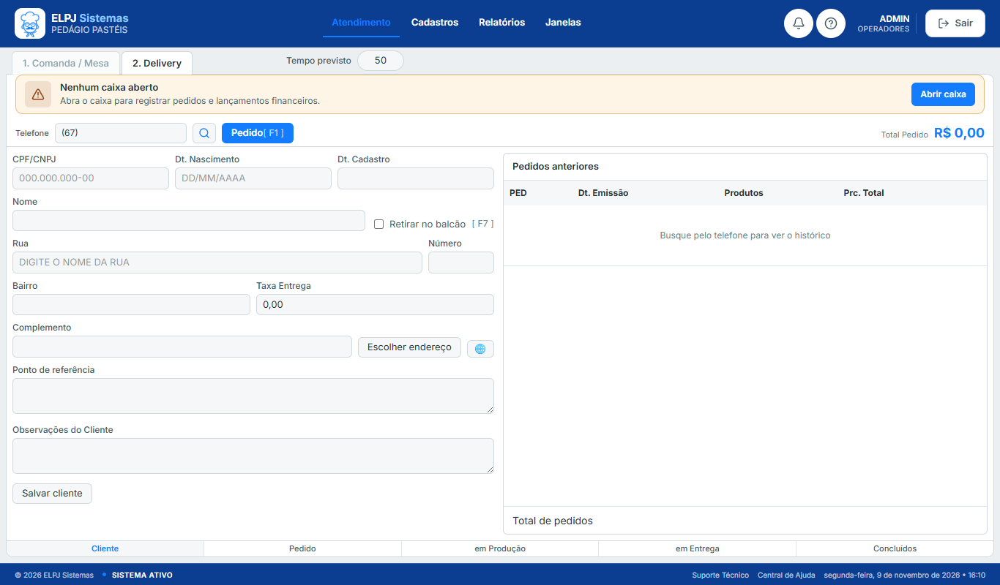
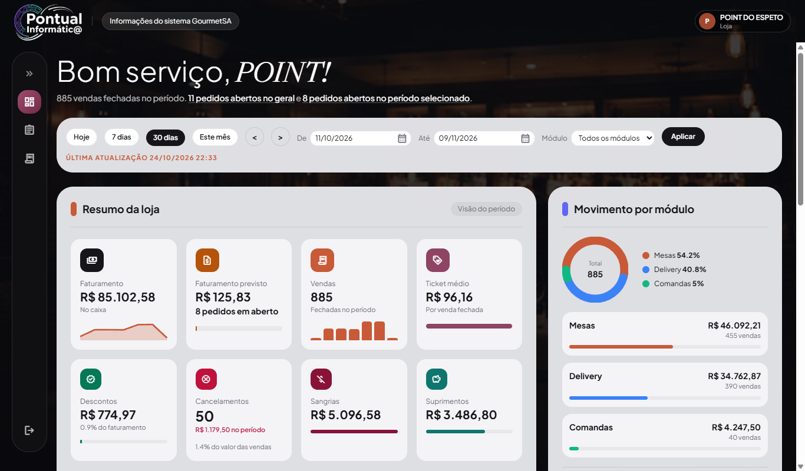

# Lucas Pereira de Andrade

Programador júnior. Desenvolvo sistemas web em produção com PHP, Laravel, MySQL, JavaScript e React.
Estágio na Prefeitura de Campo Grande (IMPCG), de março a julho de 2024.

Campo Grande – MS · lucascarlo2003@gmail.com · (67) 99349-8440

O código desses sistemas fica em repositório privado, porque está em uso por clientes. Abaixo está o que cada um faz e as telas em produção.

## Sistema web de pedidos

Em produção desde 2025. Mais de uma loja usa o mesmo sistema.

- A loja recebe o pedido pela internet.
- O painel acompanha o preparo e a entrega.
- A API em Laravel grava tudo no MySQL, com login e controle de acesso.
- O painel e a loja são telas em React.
- O pedido emite NFC-e para a SEFAZ. O sistema lê o retorno e registra a falha quando a nota não é autorizada.

Minha parte: API, banco, telas, acesso das lojas e a integração da NFC-e, inclusive correção em produção.

Loja online, no celular:

Painel de atendimento, no computador:

## Painel de vendas do caixa

Também em produção. Cada loja vê os próprios números.

- Um programa instalado na loja lê o movimento do caixa e envia para a API.
- O servidor guarda vendas, pedidos em aberto e totais do dia.
- O painel, em Laravel e MySQL, mostra totais, pedidos e gráficos por período.
- Quando a loja para de enviar, a situação muda para atenção.

Minha parte: API, banco, telas do painel e o recebimento do movimento enviado pela loja.

## Formação

- Pós-graduação em Engenharia de Software em IA Aplicada — Anhanguera — cursando, previsão 2027
- Tecnólogo em Análise e Desenvolvimento de Sistemas — Faculdade Insted — 2025
- Técnico em Informática — Instituto Federal de Mato Grosso do Sul (IFMS) — 2021

Artigo: [O uso da inteligência artificial na otimização de consultas em bancos de dados](https://periodicos.insted.edu.br/recam/article/view/142) (RECAM, Insted).
